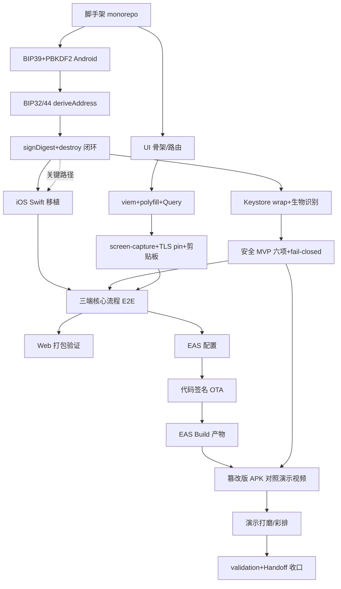

# NexVault RN/Expo 三端移植 — 3 天实施计划

- 版本：v1.1
- 日期：2026-10-14（v1.1：Day 3 补充任务 T5.4 篡改版 APK 对照演示视频录制）
- 输入：nexvault-rn_cross_verification.md、nexvault-rn_insight.md（Insight 4）、dim02（能力可行性）、dim07（native 闭环工作量）、dim11（OTA 配置项）、repo_recon（AGENTS.md 纪律与 plan.md 模板）
- 人力：1 名开发者（5 年 Android NDK、熟 Frida/Xposed、RN 初级、iOS 基础 Swift）+ AI 辅助编码
- 硬约束：**72 小时产出可演示三端原型（面试用）**。任何 3 天内无法验证的方案一律进 roadmap，不占排期。

---

## 0. 定案基线（不可推翻）

| 层 | 定案 | 依据 |
|---|---|---|
| 框架 | Expo SDK ≥57.0.21（修 Hermes v1 回归）+ CNG + Development Build | [^1^][^2^] |
| 路由 | Expo Router（版本随 SDK 57 对齐，不称 v7） | [^1^] |
| 状态/数据 | TanStack Query 5.104 + Zustand 5.0 | 调研裁决 |
| UI | NativeWind v4（v5 RC 钉带 CVE 的 worklets，排除）+ Reanimated 4.7（worklets ≥0.12.2）+ FlashList v2 | [^3^] |
| 链交互 | viem 2.56 + `react-native-get-random-values` + `fastestsmallesttextencoderdecoder` 两个 polyfill | [^4^] |
| 仓库 | pnpm workspace：`apps/mobile`（唯一 Expo app，三端同构）+ `packages/vault-core` | [^2^] |
| vault-core | expo local module 四方法：`importMnemonic(ArrayBuffer)→handle` / `deriveAddress(handle, path)` / `signDigest(handle, path, digest32)→sig` / `destroy(handle)`；JS↔native 仅传 ArrayBuffer + opaque handle | [^5^] |
| Android 密钥 | Keystore AES-GCM wrap key + 生物识别绑定包裹 secp256k1（Keystore 不支持 k1 曲线） | [^6^] |
| iOS 密钥 | expo-secure-store（Keychain）+ AES 包裹降级（Secure Enclave 通用密钥体系列 roadmap） | [^2^] |
| Web | 只读观察钱包 + WalletConnect(Reown) 桥接回手机签名，不持私钥 | [^7^] |
| OTA/构建 | EAS Update（代码签名，Production 档红线）+ EAS Build | [^8^] |
| TLS | `@bam.tech/react-native-app-security` 双 SPKI pinning（Web 端无法应用层 pinning，标注） | [^9^] |
| 安全 MVP 六项 | native 签名校验 / bundle 哈希 / Root 检测 / 越狱检测 / 反调试 / Frida 多信号 | dim08/dim09 裁决 |

**关键路径论证（Insight 4，直接决定排期）**：六项原生能力中 4 项（Keystore KV、FLAG_SECURE、manifest/Application、签名读取）有成熟路径当日可落，2 项（NDK C++ 化、Secure Enclave 通用封装）必须 roadmap；UI 层全是成熟件。因此 **Day1 上午即开工 vault-core native 模块（最高风险项），UI 骨架并行**；native 封装卡顿超半天即触发降级预案（§5 风险 a）。[^10^]

---

## 1. 排期总览

```
Day1：工程基建 + vault-core Android 闭环（关键路径）
Day2：iOS 移植 + 三端核心流程跑通 + 安全 MVP 六项落地
Day3：EAS Update 签名 OTA + EAS Build + 面试演示打磨
每天 4 时段：上午(09:00-13:00) / 下午(14:00-18:00) / 晚间(19:00-22:00) / 收尾验证(22:00-23:00)
```

### Day 1 — native 闭环日（关键路径）

| 时段 | 任务 ID | 内容 | 产出物 | 依赖 | 验收标准 |
|---|---|---|---|---|---|
| 上午 | **T1.1** | pnpm workspace 脚手架：`apps/mobile`（create-expo-app SDK ≥57.0.21）+ `packages/vault-core`（`npx create-expo-module@latest --local`）；`app.json` 写入定案身份 `io.github.realalexkwok.nexvault`（android.package / ios.bundleIdentifier，tech-stack §4）；`.npmrc` 配 `ignore-scripts=true`；lockfile 钉版 | 可 `pnpm install && pnpm --filter mobile start` 的 monorepo | 无 | `pnpm install` 成功；`npx expo-doctor` 无红项；Metro 自动 monorepo 配置生效（SDK 52+ 默认）[^2^] |
| 上午 | **T1.2（关键路径）** | vault-core Android Kotlin：BIP39 词表打包 + 校验 + PBKDF2-HMAC-SHA512（`javax.crypto.SecretKeyFactory("PBKDF2WithHmacSHA512")`，缺失机型 fallback 自实现 HMAC 循环）[^5^] | `importMnemonic` 可导入并返回 handle | T1.1 | BIP39 官方向量前 4 组 instrumentation test 全绿：`./gradlew :modules:...:connectedDebugAndroidTest`（或本地单测）输出 BUILD SUCCESSFUL |
| 下午 | **T1.3（关键路径）** | Android BIP32（secp256k1，BouncyCastle 新版打包）+ BIP44 路径解析 → `deriveAddress`（EVM：keccak256(pub)[12:]） | `deriveAddress` 返回 `0x...` 地址 | T1.2 | BIP32 官方向量全绿；已知助记词派生地址与 NexVault 原仓库记录地址一致（TC 编号溯源）[^5^] |
| 下午 | **T2.1（并行 UI）** | Expo Router 骨架 + NativeWind v4 + Reanimated 4.7 + FlashList v2 接入；4 页空壳：onboarding / home / receive / send | 三端可导航空壳（`npx expo start --web` 可看） | T1.1 | `npx expo export --platform web` 成功；Android/Web 双端路由跳转无 crash |
| 晚间 | **T1.4（关键路径）** | `signDigest`：RFC6979 确定性 ECDSA（BC 自带）；`destroy`：mnemonic→seed→各级 privkey/chaincode 全链 `fill(0)`；JS 侧 hook 封装 ArrayBuffer 生命周期（调用后 `fill(0)`） | 四方法完整闭环 | T1.3 | 构造 digest32 签名 → 用 viem `recoverAddress` 验签地址一致；重复 import/destroy 1000 次无泄漏崩溃 |
| 晚间 | **T2.2（并行 UI）** | viem 2.56 + 两个 polyfill 接入；Zustand store + TanStack Query Provider 挂载；链上余额只读查询（公共 RPC） | 地址余额可读 | T2.1 | Web/Android 输入只读地址均显示余额（命令：页面加载后观察余额非空） |
| 收尾验证 | **G1 门槛** | 按 §7 双侧验证纪律记录 | `specs/features/.../validation.md` Day1 节 | T1.4, T2.2 | 见下 |

**Day1 验收门槛（G1）**：`importMnemonic → deriveAddress → signDigest → destroy` 在**真机 Android dev build** 上全链路通过，签名可被 viem 验回同一地址。观察证据：真机屏幕录制 + `eas build` 或 `npx expo run:android --device` 日志 + 测试向量输出。若 22:00 未达 → 立即触发风险 a 降级（§5），Day2 上午重排。

### Day 2 — 三端跑通 + 安全 MVP 日

| 时段 | 任务 ID | 内容 | 产出物 | 依赖 | 验收标准 |
|---|---|---|---|---|---|
| 上午 | **T1.5** | iOS Swift 薄封装（<300 行）：CryptoSwift PBKDF2 + Blockstream `swift-secp256k1`（SPM），同四方法 API；iOS 存储走 expo-secure-store + AES 包裹降级 | iOS 侧 vault-core | T1.4 | iOS dev build 上 BIP39/32 向量全绿；`signDigest` 验签通过。若 13:00 未完成 → 触发风险 b |
| 上午 | **T3.1（并行）** | Keystore wrap：Android 自写模块内 `KeyGenParameterSpec` AES-GCM 主密钥 + 生物识别（BiometricPrompt CryptoObject）绑定包裹派生密钥；iOS 侧 SecureStore 等价封装 | 密钥材料落盘加密、生物识别门控 | T1.4 | 锁屏后调 signDigest 弹生物识别；错误指纹 3 次 fail-closed（拒绝并清零会话） |
| 下午 | **T3.2** | 安全 MVP 六项落地：①native 签名校验（`GET_SIGNING_CERTIFICATES` SHA-256 常量比对，~30 行 Kotlin）[^2^] ②bundle 哈希校验 ③Root 检测（su/Magisk 路径/属性多信号）④越狱检测 ⑤反调试（TracerPid/ptrace）⑥Frida 多信号（端口/maps/frida-server 字符串）；信号汇总为 risk score，与 signDigest **fail-closed 耦合**。**范围说明：本任务为六项的集成联调与演示路径**（fail-closed 耦合 + 干净机/Root 机对照演示所需子集：签名校验 + Root/Frida 各 1–2 个信号）；完整检测链深化（多信号交叉全覆盖）已按报告 §4.2 评估 4.5–6 人日并拆分至 roadmap/后续迭代 | `modules/security-android` 内 `runDetection()`/`assertSigningAllowed()`（接口对齐 specs/security-android.md §2.2）+ vault-core `E_VAULT_SECURITY_GATE` 门控 + JS 侧调用封装 | T3.1 | Root 检测器真机/模拟器各跑一次：干净机 risk=0 放行；Magisk 机 risk>阈值 signDigest 拒绝（演示录屏） |
| 下午 | **T3.3（并行）** | `expo-screen-capture`（同一 key 幂等调用规避 iOS #48985 黑屏 bug）[^2^] + `@bam.tech/react-native-app-security` TLS 双 SPKI pinning + 剪贴板策略（私钥路径禁复制，地址复制加 `EXTRA_IS_SENSITIVE`）[^5^] | 安全外壳 | T2.2 | Android 进助记词页截屏 = 黑图；错误 pin 时 RPC 请求被断（日志可观察） |
| 晚间 | **T4.1** | 核心流程端到端：onboarding 导入助记词 → home 余额（TanStack Query）→ receive QR → send 构造交易（viem serialize + keccak256）→ native signDigest → 广播（测试网）→ Web 端同地址只读观察 + WalletConnect 桥接占位页 | 三端核心流程 | T1.5, T3.2, T3.3 | Android 真机发出一笔测试网 tx 且链上可查（tx hash 记录入 validation.md）；Web 端显示同地址余额且无私钥路径 |
| 晚间 | **T4.2** | Web 端 viem 打包验证（Metro web resolver）；Play Integrity 占位接口 `[S]`（verdict 本地缓存降级，见风险 d） | Web 构建绿 | T4.1 | `npx expo export --platform web` 成功且浏览器 Console 无 polyfill 报错 |
| 收尾验证 | **G2 门槛** | 双侧验证记录 | validation.md Day2 节 | T4.1 | 见下 |

**Day2 验收门槛（G2）**：三端（Android 全功能 / iOS 全功能或降级 SecureStore / Web 只读）跑通「导入→查余额→签名→广播」核心流程；安全 MVP 六项在真机可演示（干净机放行 + Root/Frida 环境拦截两个对照）。若 iOS 卡环境 → 触发风险 b，演示降级 Android+Web 双端，iOS 列 roadmap 说明。

### Day 3 — OTA + 构建 + 演示打磨日

| 时段 | 任务 ID | 内容 | 产出物 | 依赖 | 验收标准 |
|---|---|---|---|---|---|
| 上午 | **T5.1** | EAS 工程接入：`eas.json`（development/preview/production 三 profile + channel）；`app.json`：`updates.url`、`runtimeVersion: { policy: "fingerprint" }`、`checkAutomatically: ON_LOAD`、`fallbackToCacheTimeout: 0`（首屏零阻塞、下次冷启动生效）[^8^] | EAS 配置 | G2 | `eas update:configure` 成功；`eas channel:list` 可见三 channel |
| 上午 | **T5.2** | EAS 代码签名：`npx expo-updates codesigning:generate` 生成 RSA 密钥对+X.509 证书；私钥存源码库外；证书内嵌 build；`eas update --private-key-path` 本地签名发布一条真实更新[^8^] | 签名 OTA 链路 | T5.1 | 真机收到签名更新并生效；篡改 manifest 后客户端拒绝加载（红线：**演示前必须开签名，不演示假签名**） |
| 下午 | **T5.3** | EAS Build：Android preview build（真机安装包）+ iOS dev build（若环境可用）；Hermes bytecode diffing 生效确认（SDK 56+ 默认，diff bundle 平均 -58%）[^8^] | 可安装构建产物 | T5.2 | `eas build --platform android --profile preview` 成功；APK 装真机全流程通过；构建产物绝对路径记入 validation.md |
| 下午 | **T5.4** | 篡改版 APK 对照演示视频录制（对自己构建的 APK 做安全验证演示，全程防御性表述）：a. 用同一套代码构建基线 release APK（正常签名版），记录官方证书 SHA-256 指纹；b. 构建篡改变体：源码条件编译注入「在私钥明文出现处上报到远程服务器」模拟桩代码（上报目标为本地 mock 服务器；优先条件编译，30 分钟内可控，规避 apktool 反编译不确定性）；c. 用不同密钥（模拟攻击者证书）重签名篡改版；d. 真机并排演示两版行为：篡改版启动即被 native 层签名校验（证书 SHA-256 指纹比对）检出 → fail-closed（不派生/不释放签名材料、拒绝进入签名流程，并给出分级处置提示）；正常版完全不受影响；e. 录屏 + 旁白要点脚本（对应报告 §3.7/§6.3「重打包木马逐层失效」与「fail-closed 是唯一 [P] 级端上控制」论证链）；f. 视频剪辑与备份 | 2-3 分钟对照演示视频（篡改版 vs 正常版）+ 旁白脚本 | T3.2, T5.3 | **面试演示用 demo 级**：篡改版启动后签名流程不可用（fail-closed 拒绝），日志/界面显示签名校验检出事件；正常版同机签名成功；视频文件产出时长 2-3 分钟 |
| 下午 | **T6.1** | 演示打磨：演示脚本（3 幕：①native 闭环签名 ②Root/Frida 拦截对照 ③OTA 签名更新生效；T5.4 篡改对照视频作为兜底录屏素材并入第 ② 幕）；演示页 UI 抛光（NativeWind）；已知限制上屏标注（[P]/[C]/[S] 三级） | 演示 runbook + 录屏备份 | T5.4 | 完整彩排 1 遍 ≤15 分钟无卡点；每幕有离线录屏兜底 |
| 晚间 | **T6.2** | 文档收口：validation.md 三日全量补齐；Handoff 清单（刻意递延项逐条裁定 implement/replan/cancel）；面试讲稿要点（威胁模型论证：重打包木马失效的本质是私钥不出 native + native 闭环签名 + 验真，而非检测层）[^11^] | 交付文档包 | T6.1 | validation.md 每个 `[x]` 均有命令+观察结果；Handoff 无静默丢弃项 |
| 收尾验证 | **G3 门槛** | 双侧验证 + 终验彩排 | validation.md Day3 节 | T6.2 | 见下 |

**Day3 验收门槛（G3）**：可安装 APK 在干净真机上演示「导入→签名→广播测试网 tx→Root 机拦截→OTA 签名更新生效」五连击；EAS 签名 OTA 真实生效（非伪造）；篡改版 APK 对照演示视频产出（篡改版 fail-closed 检出 + 正常版可用并排录屏，2-3 分钟）；所有演示宣称与 [P]/[C]/[S] 标注一致。

---

## 2. 关键路径说明

关键路径：`T1.1 → T1.2 → T1.3 → T1.4 → T1.5 → T4.1 → T5.2 → G3`。
- T1.2–T1.4（Android native 闭环）是全项目最高风险段（自研密码学 + expo local module 首次封装），故放 Day1 上午开工，预留 Day1 晚 + Day2 上午共 1.5 天缓冲（dim07 评估 D1 可完成 Android BIP39/32/44）[^5^]。
- UI（T2.1/T2.2）与安全外壳（T3.3）全部为非关键路径并行任务，任何一项超时直接砍范围（空壳页即可演示），不影响 G1。
- iOS（T1.5）依赖 Android API 定形，排 Day2 上午；超半天即降级（风险 b）。
- T5.4（篡改版 APK 对照演示视频）为非关键路径演示任务，依赖 T3.2 的签名校验 fail-closed 能力与 T5.3 构建产物；超时触发风险 h 降级，降级后仍可产出对照视频，不影响 G3 其余项。

---

## 3. 依赖关系图



---

## 4. demo 级 vs 真实防护级标注表

全局三级标注纪律：**[P] 已实现防护 / [C] 仅提高攻击成本 / [S] 占位接口**（OWASP MASVS-R 同口径；除「检测信号与密钥派生 fail-closed 耦合」外，端上检测均为 [C]）[^11^]。

| 交付物 | 级别 | 面试演示用 demo 级（3 天内） | 真实防护级（roadmap） |
|---|---|---|---|
| vault-core 四方法闭环 | **[P]**（demo 范围） | Kotlin/Swift 自研 BIP39/32/44 + ArrayBuffer 边界 + 显式清零 + 官方向量回归 | 共享 C++ 核心（libsecp256k1 经 JSI 直连）+ 常数时间保证 + 第三方密码学审计 [^5^] |
| Keystore AES-GCM wrap + 生物识别 | **[P]**（demo 范围） | AES-GCM wrap key + BiometricPrompt 门控可用 | StrongBox/Key Attestation 硬件归属绑定（TEE vs StrongBox 自验）；iOS Secure Enclave 密钥体系 [^2^][^6^] |
| Frida 检测 | **[C]** | demo 级多信号（默认端口 27042、/proc/self/maps 特征串、frida-server 进程名、named pipe） | 真实级需深化：NDK 层检测 + 时间差检测 + o-mvll 混淆 + 检测逻辑多样化轮换 [^11^] |
| Root/越狱/反调试 | **[C]** | 常规多信号（su 路径、Magisk 包名、TracerPid） | root 设备上均可被耐心攻击者绕过；真实级靠 attestation + 服务端风控兜底 |
| native 签名校验 | **[P]**（demo 范围） | SHA-256 签名常量比对，重打包即拒签 | 与 Play Integrity verdict + Key Attestation 双轨联动，服务端验 JWT [^9^] |
| bundle 哈希校验 | **[P]**（demo 范围） | manifest launchAsset hash 校验（EAS 签名自带） | 配合 EAS 代码签名轮换流程与 KMS 私钥托管 [^8^] |
| Play Integrity | **[S]** | 占位接口 + verdict 本地缓存降级演示 | 服务端 `decodeIntegrityToken` 验 JWT；STRONG 不硬卡（Android 13+ 12 个月补丁误伤）[^9^] |
| TLS pinning | **[P]**（demo 范围） | @bam.tech 双 SPKI pin（native 端） | pin 轮换预案 + Web 端明确无 pinning 能力（架构降级而非缺口）[^9^] |
| FLAG_SECURE / 剪贴板 / 键盘 | **[C]** | expo-screen-capture + 私钥路径禁剪贴板 + inputType 浅加固 | 应用内自定义词格键盘（IME 标志只是 hint 非强制）；native UI 输入使 JS 零接触助记词 [^5^] |
| EAS Update 代码签名 | **[P]** | RSA 签名 + 内嵌证书验签真实生效（不可演示假签名） | 私钥 KMS/离线保管、轮换 runbook、百分比灰度 rollout [^8^] |
| iOS mlock | **[C]** | best-effort（无文档保证，真机实测记录） | 依赖 iOS 无 swap + 显式清零 + Keychain 落盘组合达标 [^5^] |
| Web 端安全 | **[P]**（架构级） | 只读 + WalletConnect 桥接，不持私钥 | 这是产品级信任分级决策，已是最强形态 [^7^] |

---

## 5. 风险预案矩阵

| # | 风险 | 触发信号 | 降级路径 | 决策时限 |
|---|---|---|---|---|
| a | expo local module 封装不顺（autolink 失败 / ArrayBuffer 传参异常 / Gradle 冲突） | 同类阻塞问题排查 >2h 无进展；或 Day1 13:00 时 T1.2 向量未绿 | ①首选：vault-core 内部切 `@noble/curves` + `@scure/bip39` **仅作联调占位**（JS 层派生，UI/流程全通），真钱路径硬禁用（`if (!isNativeVault) throw`），界面明示 [S] 占位；②次选：Android only，iOS 整体移 Day3/roadmap。换回 native 实现时 API 签名不变 | **Day1 13:00**（Insight 4：卡顿超半天即触发）[^10^] |
| b | iOS 环境/证书问题（无 Mac 云构建排队 / 证书配置 / Swift 编译错误） | Day2 13:00 时 iOS dev build 未跑通四方法 | 演示降级为 **Android + Web 双端**；iOS 保留 expo-secure-store 降级代码与 roadmap 说明（Secure Enclave 本就 roadmap）。面试话术：信任分级表中 iOS 标注「环境受限，工程路径已验证至编译层」 | **Day2 13:00** |
| c | EAS 代码签名配置卡壳（codesigning 生成/证书内嵌/档位权限问题） | Day3 12:00 前签名更新未在真机生效 | 先无签名联调整条 OTA 链路（fingerprint + channel + rollback 演练）；**演示前必须开签名——红线：不演示假签名**。若 Production 档不可用：当场改 `updates.url` 指向 xprem 自建端点演示（签名不受档位限制，客户端改动极小）[^8^] | **Day3 12:00**；彩排前（Day3 16:00）为最后红线 |
| d | Play Integrity 配额/网络问题（频限触发、GMS 不可用、真机无网络） | 调用返回配额错误或超时 | 本地缓存最近 verdict + TTL 降级放行并打风险标记；演示时以「双轨制」话术说明：Play Integrity（有频限、证 app/设备）+ Key Attestation（无频限、证密钥硬件归属、可脱 GMS）防的是不同层 [^12^] | 即时（编码时即内置缓存路径） |
| e | Web 端 viem 打包问题（Metro web resolver 解析 crypto/stream 失败） | `npx expo export --platform web` 报模块解析错 | Metro `resolver.resolveRequest` / `extraNodeModules` 预案：为 web 显式映射 polyfill（`react-native-get-random-values` 先于 viem import、`fastestsmallesttextencoderdecoder`）；仍不通则 Web 端演示降级为静态只读页（手动输入地址查询，不走 viem 的浏览器注入路径） | **Day2 21:00**（T4.2 时段内） |
| f | pnpm 隔离安装解析异常（老库 autolinking 误扫） | `pnpm install` 后 prebuild/autolink 报错 | `.npmrc` 回退 `nodeLinker: hoisted` + `autolinking.exclude` + Metro `resolveRequest` 双层屏蔽；>2h 未解则降级单 Expo 工程 + `src/core` 目录（Metro 自动配置保证迁移成本低）[^2^] | **Day1 11:00** |
| g | EAS Build 云排队超时 | Day3 15:00 无构建产物 | 本地 `npx expo run:android --variant release` 出 APK 演示；EAS Build 状态截图留证 | Day3 15:00 |
| h | 篡改对照演示条件编译桩来不及（注入桩与本地 mock 服务器联调超时） | Day3 16:00 前篡改变体未构建成功 | 降级为「仅演示签名校验拒绝未知证书 APK」：基线 release APK 直接用不同密钥重签名（无注入桩），即可演示 native 层证书 SHA-256 指纹比对 → fail-closed 拒绝进入签名流程；旁白说明注入上报桩为演示增强项，fail-closed 检出点与论证链（报告 §3.7/§6.3）不变 | Day3 16:00（彩排前） |

---

## 6. Roadmap（明确不进 3 天排期）

NDK C++ 共享核心（libsecp256k1 JSI 直连）；iOS Secure Enclave 通用密钥体系；StrongBox/Key Attestation 硬件绑定；native UI 自定义词格键盘；Play Integrity 服务端验签 + 双轨分级矩阵；o-mvll 混淆；SQLCipher 库加密；xprem 自建 OTA 迁移评估（$199/月档位决策点）；Android Developer Console 注册（2027 全球扩展前）[^13^]。

---

## 7. 与 AGENTS.md 的衔接（双侧验证纪律）

遵循原仓库 AGENTS.md 验证纪律：「Never write 'done' without a command and its observed result」[^14^]。

1. **规格目录**：本计划对应 `specs/features/2026-10-14-rn-port/plan.md`；每个 Day 的收尾验证结果写入同目录 `validation.md`，每任务一节。
2. **状态三档**：`[x]` 已验证 / `[~]` 已实现未验证 / `[ ]` 未开始。计划表中任何任务标记 `[x]` 必须同时满足：
   - **自动侧**：命令代码块 + 观察结果（BUILD SUCCESSFUL / exit code / 测试向量输出）+ 构件绝对路径（如 APK、tx hash、EAS update ID）；
   - **手工侧**：真机走查记录（Pixel 级实体机；屏幕录制路径），模拟器结果不计入 `[x]` 的手工侧。
3. **每日收尾验证（22:00-23:00）固定动作**：
   - 汇总当日所有验收命令的重跑结果（命令原样粘贴 + 输出摘要）；
   - 对照当日 G 门槛逐项判定 Pass/Fail，Fail 项立即写入风险矩阵触发行并注明降级决策与时间戳；
   - Handoff 清单登记刻意递延项，次日规划轮逐条裁定（implement/replan/cancel），不得静默丢弃。
4. **安全红线继承**：永不 log 私钥/助记词；永不落盘未加密密钥材料；演示中任何「看起来能用」的假数据禁止（缺配置就显示 Not configured）[^14^]。
5. **诚实标注红线**：演示与文档中禁止把 [C] 级检测写成「防护」；[P]/[C]/[S] 三级标注贯穿全部交付物（§4）[^11^]。

---

## 来源

[^1^]: nexvault-rn_cross_verification.md H1/H8：Expo SDK 57（RN 0.86）、锁 ≥57.0.21；Expo Router 版本随 SDK 对齐 ~57.x，不称 v7。
[^2^]: nexvault-rn_dim02.md §1/§4/§5：六项能力 Expo 路径与成熟度；pnpm workspace + 单 Expo app + packages/vault-core；pnpm 隔离安装与 hoisted 回退；签名读取自写本地模块半天工程量。
[^3^]: nexvault-rn_cross_verification.md C5/M7：NativeWind v5 RC 钉住带 CVE-2026-97724 的 worklets 0.10.1 → 选 v4；Reanimated 4.7 需 worklets ≥0.12.2；FlashList v2 免 estimatedItemSize。
[^4^]: nexvault-rn_cross_verification.md H7：viem 优于 ethers v6；「构造→序列化→keccak256→native 签名→广播」为 viem 一等 API。
[^5^]: nexvault-rn_dim07.md §0/§4/§5/§7：四方法 local module 定案；ArrayBuffer 边界；PBKDF2 fallback；BIP39/32 官方向量回归；iOS CryptoSwift + swift-secp256k1 薄封装 <300 行；3 天 D1-D3 排期依据；mlock 与剪贴板/键盘结论。
[^6^]: nexvault-rn_cross_verification.md H5：Keystore/StrongBox 不支持 secp256k1；主流钱包采用 Keystore AES-GCM wrap + 生物识别绑定模式。
[^7^]: nexvault-rn_cross_verification.md H6：Web 不持私钥、只读 + WalletConnect(Reown) 桥接，三源一致。
[^8^]: nexvault-rn_dim11.md §0/§2/§6/§7：EAS 代码签名仅 Production/Enterprise；codesigning:generate 流程；fingerprint runtimeVersion 策略；checkAutomatically/fallbackToCacheTimeout；bytecode diffing -58%；xprem 自建签名不受档位限制且客户端只改 updates.url。
[^9^]: nexvault-rn_cross_verification.md H9/H12：Play Integrity 三级 verdict、STRONG 不宜硬卡；@bam.tech/react-native-app-security 双 SPKI pin、Web 无法应用层 pinning。
[^10^]: nexvault-rn_insight.md Insight 4：3 天关键路径在 native 闭环不在 UI；Day1 vault-core 最高优先级、UI 并行；卡顿超半天触发 JS noble/curves 降级占位。
[^11^]: nexvault-rn_cross_verification.md §四 + nexvault-rn_insight.md Insight 5：[P]/[C]/[S] 三级标注；检测层为攻击成本定价器；重打包木马失效的本质论证。
[^12^]: nexvault-rn_insight.md Insight 7 + cross_verification C3：Play Integrity 与 Key Attestation 双轨制的风险分级语义。
[^13^]: nexvault-rn_cross_verification.md H10/M4 + dim02 §1②⑥ + dim11 §6：roadmap 项来源。
[^14^]: nexvault-rn_repo_recon.md ①：AGENTS.md 验证纪律、安全红线、Handoff 制度。

---

## 修订记录

- 2026-10-19（v1.3）：**插入 T2.1a 视觉对齐原仓库**（owner 裁定 route A / scope A）——位置：**T2.1 之后、T2.2 之前**（Day 1 末并行 UI 段；T2.1a = T2.1 的后续子条目）；**T2.2 编号与内容不变**（viem + polyfill + Zustand/Query + 余额只读）；范围：原 Kotlin 工程（`/home/superguo/Projects/NexVault` @ `3c7487f`）设计系统全量移植——tokens（暗色 M3 色板 `#0A0E1A/#121829/#1A1F35/#141928/#2D5AF0/#00D4AA/#7B61FF/#FF4C6E`、Inter、M3 字号阶梯、形状 4/8/12/16/24、间距阶梯 2/4/8/16/24/32/48、按钮 52/输入 56）、原语组件（NexVaultCard 平面 1dp 描边 16 圆角 / NexVaultButton / NexVaultTextField / NexVaultTopBar 透明居中 18sp）、chrome（透明居中 TopBar、Home 无 bar 由链选择器领起）、5-tab 底部导航（Home/History/DApp/NFT/Settings，DApp/NFT/Settings 先占位）。验收口径：`tsc --noEmit`、`expo export --platform web`、Android/Web 路由 smoke、视觉对照走查（MAN 登记）、R1/R5/R7 门禁、零非批准依赖（Inter 经 expo-font——SDK 绑定单元，规划轮按 R4 核）；规划轮修订 `specs/ui-wallet.md` §2.1 路由表与 §2.3 设计令牌。**T2.1 保持关闭不重开；T2.2 不变**；T2.1a 的 Handoff 裁定（T2.1-H3…H9）在其规划轮完成。
- 2026-10-16（v1.2）：**T1.5 iOS KDF 定案为 CommonCrypto `CCKeyDerivationPBKDF`**（系统框架，零第三方依赖；owner 批准，T1.5 硬门槛 gate-3 裁决）——原 T1.5 行的 CryptoSwift 措辞作废（CryptoSwift 弃用；CryptoKit 无 PBKDF2，不可用）；`doc/research-report.md` §3.5 内嵌计划表的 CryptoSwift 措辞为只读存档，冲突以本追记 + `specs/vault-core.md` §2.3 为准。swift-secp256k1 仓库现为 **21-DOT-DEV**（Blockstream 原名已迁移），R4 钉版提案在 T1.5 规划轮。
- 2026-10-14（v1.1）：Day 3 补充任务 **T5.4 篡改版 APK 对照演示视频录制**（对自己构建的 APK 做安全验证演示）；同步更新 T6.1 依赖（T5.3→T5.4）、§2 关键路径说明、§3 依赖关系图、Day3 验收门槛 G3（纳入「篡改对照演示视频产出」）、§5 风险预案 h（条件编译桩降级路径）。
